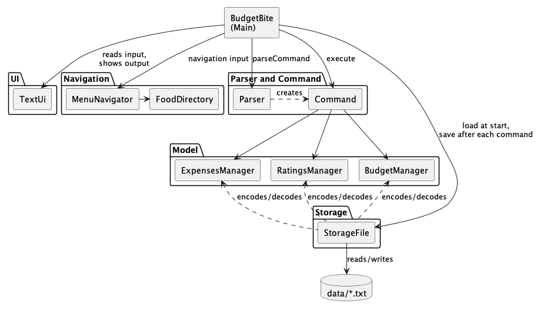
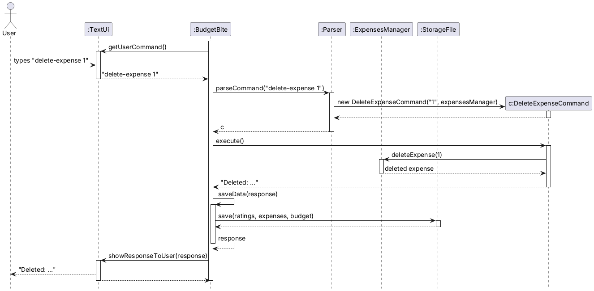
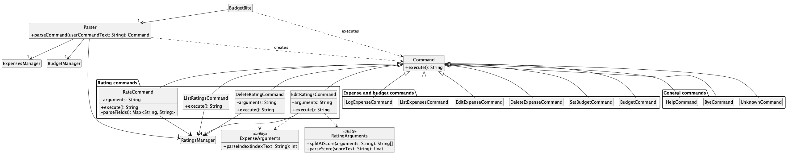
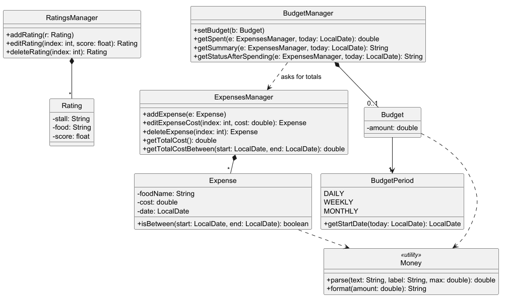
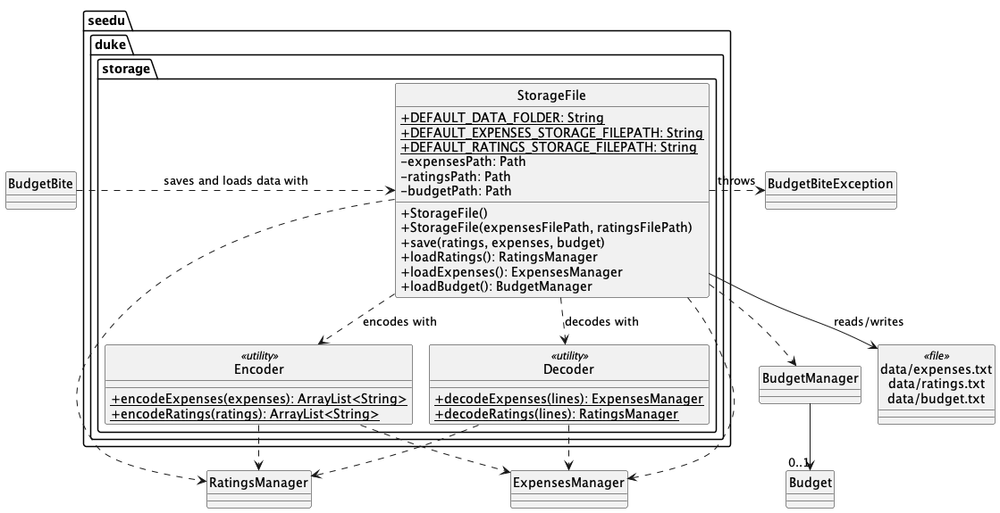
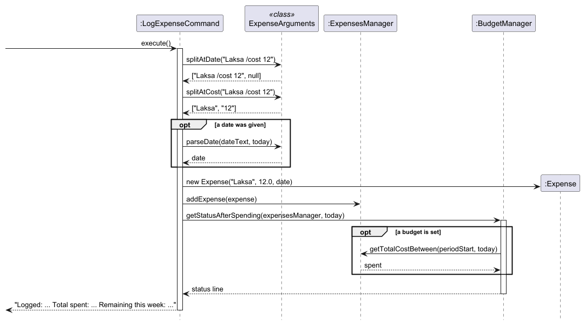
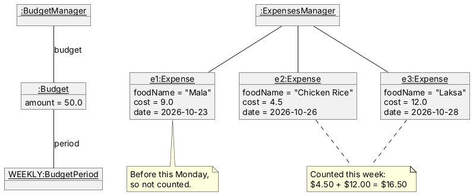
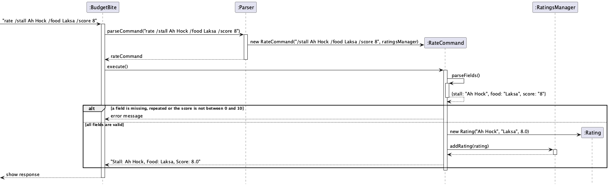
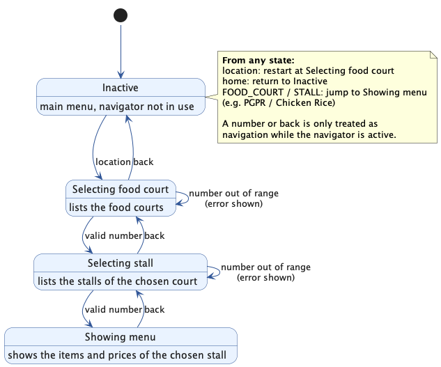
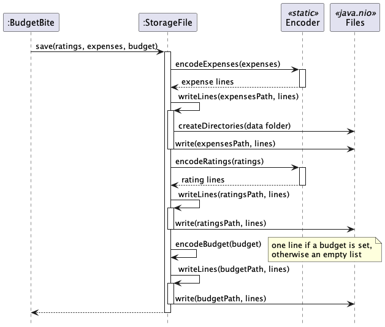

# Developer Guide

## Acknowledgements

* The project template, and the structure of this Developer Guide and the User Guide, are adapted from
  [AddressBook-Level3](https://se-education.org/addressbook-level3/) by the [SE-EDU initiative](https://se-education.org/).
* The design of `TextUi`, `StorageFile`, `Encoder` and `Decoder` is adapted from the SE-EDU AddressBook-Level2 template
  provided for this course.
* Third-party tools: [JUnit 5](https://junit.org/junit5/) for testing, [Gradle](https://gradle.org/) with the
  [Shadow plugin](https://gradleup.com/shadow/) for building, [Checkstyle](https://checkstyle.org/) for code style, and
  [PlantUML](https://plantuml.com/) for the diagrams.
* AI use: team members used AI assistants (such as Claude and Codex) to help draft parts of the code, tests and
  documentation. All AI-generated content was reviewed, tested and edited by the team.

## Setting up, getting started

1. Fork and clone the repo, then open it in IntelliJ IDEA as a Gradle project.
2. Make sure the project uses JDK 25 (File > Project Structure > Project SDK).
3. Run `seedu.duke.BudgetBite#main` to launch the app, or run `.\gradlew run`.
4. Run `.\gradlew check` to run the tests and Checkstyle, and
   `.\gradlew shadowJar` to build `build/libs/BudgetBite.jar`.

## Design

:bulb: **Tip:** The `.puml` files used to draw the diagrams in this guide are in the `docs/diagrams` folder.

### Architecture

*Figure: The main parts of BudgetBite and how they depend on each other.*

The ***Architecture Diagram*** above shows the high-level design of BudgetBite.

`BudgetBite` (the main class) is in charge of launching the app, running the
command loop and shutting down:

* At launch, it loads the saved data through `StorageFile`, and creates the
  `TextUi`, `MenuNavigator` and `Parser`.
* For each line the user types, it decides who handles it: navigation input
  (such as `location`, `back`, a number while browsing, or `FOOD_COURT / STALL`)
  goes to `MenuNavigator`, and everything else goes to `Parser`.
* After every input, it saves all data through `StorageFile`, then shows the
  response through `TextUi`.

The rest of the app consists of these components:

* **UI** (`TextUi`): reads input from, and writes output to, the console.
* [**Parser and Command**](#parser-and-command-component): turns a line of input
  into a `Command` and runs it.
* [**Model**](#model-component): holds the user's data in memory: ratings,
  expenses and the budget.
* [**Navigation**](#navigation-component): lets the user browse food courts,
  stalls and menus, which `FoodDirectory` loads from `food.txt` inside the JAR.
* [**Storage**](#storage-component): reads the data files in the `data` folder at
  launch and writes them after every input.

**How the components interact with each other**

The sequence diagram below shows how the components work together when the user
enters `delete-expense 1`.

*Figure: The components working together for `delete-expense 1`.*

1. `BudgetBite` asks `TextUi` for the next command, and gets `delete-expense 1`.
2. It is not navigation input, so `BudgetBite` passes it to
   `Parser#parseCommand`, which creates a `DeleteExpenseCommand`.
3. `BudgetBite` calls `execute()` on the command, which deletes the expense
   through `ExpensesManager` and returns a message.
4. `BudgetBite` saves all data through `StorageFile` (in `saveData`), then shows
   the message through `TextUi`.

### Parser and Command component

**API:** `Parser.java`, `Command.java`

*Figure: `Parser` creates one `Command` subclass for each command word; `BudgetBite` then executes it.*

The `Parser` turns what the user typed into a `Command` object, and each
`Command` does the actual work when it is executed. Every command is a
subclass of `Command` and overrides `execute()`. The managers a command works
on are passed in when it is created, as described below.

1. `BudgetBite` reads a line of input. Navigation input (`home`, `location`,
   `FOOD_COURT / STALL`, and, while browsing, `back` or a number, as decided by
   `MenuNavigator#isNavigationInput`) goes to `MenuNavigator` (see
   [Navigation component](#navigation-component)). Everything else goes to
   `Parser#parseCommand`.
2. `Parser` splits the input into the command word (not case-sensitive) and the
   rest of the line (the arguments). It creates the matching command, giving it
   the arguments and only the managers that command needs. For example,
   `RateCommand` gets the `RatingsManager` and the `FoodDirectory`. Unknown command words give an
   `UnknownCommand`, which points the user to `help`.
3. `BudgetBite` calls `Command#execute()`, which returns the response as a
   `String`. All data is saved, and then `TextUi` shows the response. Data is
   also saved after navigation input, since a rating can be added while
   browsing.

Each command checks its own arguments inside `execute()`. Input rules shared by
several commands are kept in helper classes: `RatingArguments` for scores and
`ExpenseArguments` for costs, dates and indexes. When the input is invalid, the
command returns an error message together with the correct format, instead of
throwing an exception. As a safety net, `BudgetBite#executeCommand` catches any
unexpected exception, so a single bad command cannot crash the app and lose the
user's data.

#### Design considerations

**Aspect: Where the arguments of a command are parsed**

* **Alternative 1 (current choice):** `Parser` only picks the command; each
  command parses its own arguments.
    * Pros: `Parser` stays short, and all the rules of a command are in one
      class, so a new command does not change how the others work.
    * Cons: Commands with similar input must share helper classes, such as
      `ExpenseArguments`, to stay consistent.
* **Alternative 2:** `Parser` parses all arguments and passes ready-made values
  (e.g. an `int` index) to each command.
    * Pros: Commands only contain the logic of the feature.
    * Cons: `Parser` grows with every command and needs to know the input rules
      of every feature.

**Aspect: How a command shows its result**

* **Alternative 1 (current choice):** `execute()` returns the response as a
  `String`, and `BudgetBite` passes it to `TextUi`.
    * Pros: Commands do not depend on the UI, and tests can simply check the
      returned text.
    * Cons: A command cannot show output in several steps.
* **Alternative 2:** Commands print their output directly through `TextUi`.
    * Pros: More flexible output.
    * Cons: Every command depends on the UI, and tests have to capture what is
      printed.

### Model component

*Figure: Classes that hold the user's ratings, expenses and budget while the app runs.*

The model holds all user data in memory while the app runs:

* `RatingsManager` holds a list of `Rating`s (stall, food and a score from 0 to 10).
* `ExpensesManager` holds a list of `Expense`s (food name, cost and date). It can
  total all expenses, or only those between two dates.
* `BudgetManager` holds at most one `Budget` (a `BudgetPeriod` and an amount). It
  works out how much of the budget has been spent by asking `ExpensesManager`
  for totals.
* `Money` is the single place for the rules about amounts of money (positive, at
  most 2 decimal places, a maximum) and for formatting amounts as `$4.50`. Its
  methods are static (shown underlined), as it holds no data of its own.

Indexes in the public methods of the managers start from 1, matching the
numbers the user sees in `list-ratings` and `list-expenses`. Each manager checks
the index and throws a `BudgetBiteException` with a helpful message if it is
out of range.

### Navigation component

**API:** `MenuNavigator.java`, `FoodDirectory.java`, `FoodDataLoader.java`

The navigation component allows users to browse food courts, food stalls, and
menu items.

`FoodDirectory` loads the food catalogue from `src/main/resources/food.txt` using
`FoodDataLoader`. Each non-blank line has the format
FOOD_COURT|STALL|FOOD_ITEM|PRICE. The loader groups these rows into
`FoodCourt`, `FoodStall`, and `FoodItem` objects. The resulting food data is
read-only during execution.

`MenuNavigator` controls the user's current browsing position. It stores the
current navigation stage, the selected food court, the selected stall and the
selected dish. It also holds the `RatingsManager`, so that a dish can be rated
from its menu. The food data is read-only during execution.

The navigator is used by `BudgetBite`. When the user enters `location`, the
application starts the navigation flow. While navigation is active,
`MenuNavigator#isNavigationInput` decides which input it handles: `back`, and
whole numbers, or anything that looks like a score while a dish is being rated.
Other input, such as `list-ratings`, still runs as a normal command. The `home`
command returns the user to the main menu from any navigation stage.

### Storage component

**API:** `StorageFile.java`

*Figure: `StorageFile` saves and loads the data, using `Encoder` and `Decoder`.*

* `StorageFile` saves and loads the three data files: `data/expenses.txt`,
  `data/ratings.txt` and `data/budget.txt`. The `data` folder is next to wherever
  the app is run from, e.g. next to the JAR, and is created on the first save.
* `Encoder` turns ratings and expenses into lines of text, and `Decoder` turns
  lines back into objects. Their methods are static (shown underlined), as they
  hold no data. Each `Expense`, `Rating` and `Budget` knows its own line format
  (`toStorageString()` and `fromStorageString()`).
* Loading never stops the app: a missing file gives an empty list, and a line in
  the wrong format is skipped. `StorageFile` counts the skipped lines of each
  file, copies that file to a backup (e.g. `data/expenses.txt.bak`) because the
  skipped lines will not be written back on the next save, and keeps a note that
  `BudgetBite` shows after the welcome message.
* Log messages below `SEVERE` are kept off the console (`BudgetBite#hideLogsFromConsole`),
  so users only see messages meant for them.

## Implementation

This section describes how some of the features are implemented.

### Logging an expense

#### Implementation

Users log what they spend on food with `log-expense FOOD_NAME /cost AMOUNT
[/date YYYY-MM-DD]`. Each `Expense` holds a food name, a cost and a date, and all
expenses are kept in an `ExpensesManager`. The related commands `list-expenses`,
`edit-expense` and `delete-expense` work on the same list.

The sequence diagram below shows how `log-expense Laksa /cost 12` is executed
when a budget is set.

*Figure: Executing `log-expense Laksa /cost 12`. `<<class>>` marks calls to static methods of `ExpenseArguments`.*

1. `LogExpenseCommand` uses `ExpenseArguments#splitAtDate` to split off an
   optional `/date`, then `ExpenseArguments#splitAtCost` to separate the food
   name from the cost.
2. `Expense#parseCost` checks the cost using `Money`: it must be a plain number
   more than 0 and at most 1000, with at most 2 decimal places. `BigDecimal` is
   used for this check, because it keeps the digits exactly as typed.
3. If a date was given, `ExpenseArguments#parseDate` checks that it is a real
   date in the format `YYYY-MM-DD` and not in the future. Otherwise, today's
   date is used.
4. The new `Expense` is added to `ExpensesManager`.
5. `BudgetManager#getStatusAfterSpending` adds a line about the budget to the
   response (see [Checking spending against a budget](#checking-spending-against-a-budget)).

`Expense` objects cannot be changed after creation. `edit-expense` creates a
copy with the new cost (`Expense#withCost`), which keeps the original date, and
puts it in place of the old one. Expenses are saved to `data/expenses.txt` in
the format `FOOD_NAME|COST|DATE`.

#### Design considerations

**Aspect: Where the input of expense commands is parsed**

* **Alternative 1 (current choice):** In a shared helper class, `ExpenseArguments`.
    * Pros: `log-expense`, `edit-expense` and `delete-expense` reject bad input
      with the same messages, and the parsing is tested once.
    * Cons: One more class.
* **Alternative 2:** Inside each command.
    * Pros: Each command is self-contained.
    * Cons: Duplicated code, and the commands can drift apart in what they accept.

**Aspect: How costs are stored**

* **Alternative 1 (current choice):** As `double`, limited to 2 decimal places
  when typed, and always shown rounded to 2 decimal places.
    * Pros: Simple arithmetic and formatting.
    * Cons: Tiny rounding errors in sums, e.g. `0.1 + 0.2`, which must be allowed
      for when comparing amounts.
* **Alternative 2:** As `BigDecimal` everywhere.
    * Pros: Exact amounts.
    * Cons: Every calculation and comparison becomes more verbose. At the
      amounts involved, `double` is accurate enough.

**Aspect: How commands find out today's date**

* **Alternative 1 (current choice):** Commands take an optional `LocalDate today`
  in their constructor; the app passes the real date.
    * Pros: Tests pass a fixed date, so they give the same result on any day.
    * Cons: An extra constructor in each date-dependent command.
* **Alternative 2:** Call `LocalDate.now()` inside the commands.
    * Pros: Simpler constructors.
    * Cons: Tests of dates and budgets would pass or fail depending on the day
      they are run.

### Checking spending against a budget

#### Implementation

A `Budget` holds a `BudgetPeriod` (`DAILY`, `WEEKLY` or `MONTHLY`) and an
amount. `BudgetManager` holds the user's one budget, if set.

* `set-budget PERIOD AMOUNT` (`SetBudgetCommand`) reads the period with
  `BudgetPeriod#fromKeyword` and the amount with `Budget#parseAmount`, then
  replaces any existing budget.
* `budget` (`BudgetCommand`) shows `BudgetManager#getSummary`: the budget, what
  was spent in the current period, and what is left.

**Working out what was spent.** Each `BudgetPeriod` knows the first day of the
current period: today for `DAILY`, this Monday for `WEEKLY`
(`TemporalAdjusters.previousOrSame(MONDAY)`), and the 1st of the month for
`MONTHLY`. `BudgetManager#getSpent` then calls
`ExpensesManager#getTotalCostBetween(startDate, today)`, which adds up the
expenses dated in that range.

The object diagram below shows the objects after `set-budget weekly 50` and three
logged expenses, when today is Wednesday 2026-10-28. The week started on Monday
2026-10-26, so `BudgetManager` asks `ExpensesManager` for the total from
2026-10-26 to 2026-10-28. Only `e2` and `e3` are in that range, so $16.50 of the
$50.00 budget is used.

*Figure: Objects for a weekly budget. Only expenses dated in the current week count towards it.*

**Warnings.** After each `log-expense`, `BudgetManager#getStatusAfterSpending`
returns:

* `Warning: you are $X over your ... budget!` if spending is over the budget;
* otherwise `Careful: you have used N% of your ... budget.` plus the remaining
  amount, if 80% (`NEAR_LIMIT_RATIO`) or more is used;
* otherwise just the remaining amount.

A tiny tolerance is allowed when checking whether the user is over the budget,
so floating-point errors never count as being over. The budget is saved to
`data/budget.txt` in the format `PERIOD|AMOUNT`, e.g. `weekly|50.00`.

#### Design considerations

**Aspect: How the amount spent is tracked**

* **Alternative 1 (current choice):** Calculate it each time from the dated
  expenses in `ExpensesManager`.
    * Pros: Editing, deleting or back-dating an expense is reflected in the
      budget straight away, and the budget and the expense list can never
      disagree. A new period starts automatically.
    * Cons: Goes through all expenses each time; fast enough for thousands of
      expenses.
* **Alternative 2:** Keep a running total in `BudgetManager`, updated by each
  expense command.
    * Pros: No need to go through the expenses.
    * Cons: Every expense command must update the total correctly, and the total
      must be reset when a new period starts. Easy to get wrong.

**Aspect: How many budgets a user can have**

* **Alternative 1 (current choice):** One budget at a time; `set-budget`
  replaces it.
    * Pros: Simple commands and messages.
    * Cons: Users cannot track, for example, a weekly and a monthly limit together.
* **Alternative 2:** One budget per period.
    * Pros: More flexible.
    * Cons: Needs extra commands to choose and delete budgets, and longer
      messages after each expense.

### Rating food

#### Implementation

The rating feature lets users rate, list, edit and delete ratings of the food
they ate (`rate`, `list-ratings`, `edit-rating`, `delete-rating`). Each `Rating`
holds a location (food court), a stall name, a food name and a score from 0 to
10, and all ratings are kept in a `RatingsManager`.

The sequence diagram below shows how
`rate /location PGPR /stall Chicken Rice /food Roast Chicken Rice /score 8`
is executed.

*Figure: Executing a `rate` command. The stall and food are then checked with `FoodCourt#findStall` and `FoodStall#findItem`.*

1. `Parser` sees the command word `rate` and creates a `RateCommand` with the
   rest of the line, the `RatingsManager` and the `FoodDirectory`.
2. `RateCommand#parseFields` splits the arguments into words. A word starting
   with `/` starts a new field, and the words after it, up to the next field,
   are its value. So names can contain spaces, and the fields can be in any
   order. The input is rejected if a field is unknown, repeated, empty or
   missing, or if there is text before the first field.
3. The location, stall and food are looked up in that order with
   `FoodDirectory#findFoodCourt`, `FoodCourt#findStall` and
   `FoodStall#findItem`, ignoring letter case. If one is not found, the error
   lists the valid names at that level, e.g. the stalls in that food court.
4. `RatingArguments#parseScore` reads the score. It must be a plain number from
   0 to 10 with at most 1 decimal place, so inputs that `Float.parseFloat` would
   accept, such as `NaN`, `5f` or `1e1`, are rejected. Limiting the score to 1
   decimal place means the score shown and saved is exactly the one typed.
5. A new `Rating` is created with the names as they appear in the catalogue,
   e.g. `PGPR` even if the user typed `pgpr`, and added with
   `RatingsManager#addOrReplaceRating`. The `Rating` constructor checks every
   field again and throws a `BudgetBiteException` if one is invalid, so an
   invalid `Rating` can never exist, even when it is created while loading the
   data file.
6. `addOrReplaceRating` looks for an earlier rating of the same dish with
   `Rating#isSameDish`, which compares the location, stall and food. If there
   is one, the new rating takes its place in the list, so its index does not
   change, and the old rating is returned. `RateCommand#describeRating` then
   shows `Updated: ... (was 8.0/10)` instead of `Rated: ...`. Rating from the
   menu (`MenuNavigator`) uses the same two methods, so both ways behave the
   same. `RatingsManager#addRating`, which always adds, is still used when
   loading the data file.

If the arguments end with `?`, `RateCommand` passes them to `RateSuggestions`
instead of rating. `TextUi#getUserCommand` turns a Tab at the end of a line into
` ?`, so pressing Tab then Enter does the same. `RateSuggestions#suggest` splits
the arguments with the same `RateCommand#splitIntoFields`, takes the last field
typed as the one being completed, and lists the catalogue names at that level
that contain the text typed so far, ignoring letter case. For example,
`rate /location PGPR /stall ch ?` lists `Chicken Rice, Chef Wok`. Stall and food
suggestions need the earlier fields, so they are looked up with the same
`findFoodCourt` and `findStall` methods as a real rating, and give the same
errors. If the last word is a partly typed field name, such as `/st`, the
matching field names are listed instead.

`edit-rating INDEX /score SCORE` uses `RatingArguments#splitAtScore` and
`RatingArguments#parseScore` to read the new score, and
`ExpenseArguments#parseIndex` to read the index. `Rating` objects cannot be
changed after creation, so `RatingsManager#editRating` calls
`Rating#withScore`, which creates a new `Rating` with the same location, stall
and food and the new score, and puts it in place of the old one.
`delete-rating INDEX` reads the index the same way and calls
`RatingsManager#deleteRating`.

Ratings are saved to `data/ratings.txt` in the format
`LOCATION|STALL|FOOD|SCORE`, e.g. `PGPR|Chicken Rice|Roast Chicken Rice|8.0`.
`Rating#fromStorageString` also reads the older `STALL|FOOD|SCORE` format and
gives such ratings the location `Unknown location`, so ratings saved by older
versions are not lost. Names cannot contain `|`, as it would break the line.
Invalid lines are skipped when the file is loaded.

#### Design considerations

**Aspect: Format of the `rate` command**

* **Alternative 1 (current choice):** Named fields: `/location`, `/stall`,
  `/food` and `/score`.
    * Pros: Names can contain spaces, the fields can be typed in any order, and
      the command is easy to read.
    * Cons: More to type, and needs its own parsing code.
* **Alternative 2:** Fixed positions, e.g. `rate STALL FOOD SCORE`.
    * Pros: Shorter to type.
    * Cons: Names with spaces, such as `Chicken Rice`, cannot be told apart from
      the next field.

**Aspect: Which dishes can be rated**

* **Alternative 1 (current choice):** Only dishes in the food catalogue, and
  the food court must be given.
    * Pros: Ratings always match what the user sees when browsing, typos are
      caught, and stall names that exist in more than one food court (e.g.
      `Chicken Rice` in PGPR and TECHNO EDGE) are never ambiguous.
    * Cons: Users cannot rate food from places that are not in `food.txt`.
* **Alternative 2:** Accept any stall and food name.
    * Pros: Users can rate anything.
    * Cons: Typos and differences in letter case create separate ratings for the
      same dish, and ratings cannot be linked to the menus.

**Aspect: Helping users find names**

* **Alternative 1 (current choice):** End the command with `?` or Tab, then
  press Enter, to list the options.
    * Pros: Works with the plain `Scanner` input, the same on every operating
      system, in IDE consoles and in automated tests. No third-party library.
    * Cons: Names are not filled in on the spot; the user retypes the command.
* **Alternative 2:** Real Tab completion using a library such as JLine.
    * Pros: Works like a shell; Tab fills in the name immediately.
    * Cons: Java only receives a line after Enter unless the terminal is put in
      raw mode, which needs the library. It adds a dependency that needs
      approval, behaves differently in some consoles, and makes input tests
      harder.

**Aspect: How a score is edited**

* **Alternative 1 (current choice):** `Rating` cannot be changed; editing
  replaces it with a new `Rating`.
    * Pros: All checks are in the `Rating` constructor, and a `Rating` cannot be
      changed by accident from elsewhere in the code.
    * Cons: A new object is created for every edit.
* **Alternative 2:** Add a `setScore` method to `Rating`.
    * Pros: Simpler edit code.
    * Cons: The score check must be repeated in the setter, and any code holding
      a `Rating` could change it.

### Food navigation

#### Implementation

`MenuNavigator` uses five stages to represent the user's current position:

* `INACTIVE`: The user is not browsing food locations.
* `SELECTING_LOCATION`: The user is choosing a food court.
* `SELECTING_STALL`: The user is choosing a stall within the selected food court.
* `SHOWING_MENU`: The numbered menu of the selected stall is displayed.
* `RATING_ITEM`: The user chose a dish from the menu and is asked for its score.

*Figure: The stages of `MenuNavigator` and the input that moves between them.*

The normal browsing flow is as follows:

1. The user enters `location`.
2. `MenuNavigator#start()` changes the stage to `SELECTING_LOCATION` and
   displays the available food courts.
3. The user enters a number to select a food court.
4. The navigator changes the stage to `SELECTING_STALL` and displays the
   stalls in that food court.
5. The user enters a number to select a stall.
6. The navigator changes the stage to `SHOWING_MENU` and displays the stall's
   numbered menu and prices.
7. The user enters a number to select a dish. The navigator changes the stage to
   `RATING_ITEM` and asks for a score.
8. The user enters a score. The navigator reads it with
   `RatingArguments#parseScore`, the same rules as the `rate` command, creates a
   `Rating` with the selected food court, stall and dish, and adds it to the
   `RatingsManager`. The stage goes back to `SHOWING_MENU` and the menu is shown
   again, so the user can rate another dish. If the score is invalid, the stage
   stays at `RATING_ITEM` and the user is asked again.

The `back` command moves the user one level backwards:

* From `RATING_ITEM`, it cancels the rating and shows the menu again.
* From `SHOWING_MENU`, it returns to the stall list.
* From `SELECTING_STALL`, it returns to the food-court list.
* From `SELECTING_LOCATION`, it returns to the main menu.

The `home` command clears the selected food court, stall and dish, changes the
stage to `INACTIVE`, and returns the user to the main menu.

Users can also navigate directly to a stall using the format:

`FOOD_COURT / STALL`

For example:

`PGPR / Chicken Rice`

The food court and stall names are matched without regard to letter case. The
input is split around the slash, and the navigator checks that the food court
and stall exist before displaying the menu. Inputs with missing parts or more
than one slash are rejected with a format error.

Invalid numeric selections do not change the current navigation stage. Instead,
the navigator returns an error message and waits for another input.

#### Design considerations

**Aspect: Representing the browsing position**

* **Alternative 1 (current choice):** Use an explicit `Stage` enum with
  `INACTIVE`, `SELECTING_LOCATION`, `SELECTING_STALL`, `SHOWING_MENU` and
  `RATING_ITEM`.
    * Pros: Each input is interpreted according to the user's current position,
      making the navigation flow clear and easy to test.
    * Cons: Adding another navigation level requires adding another stage.
* **Alternative 2:** Store only the selected food court and stall, without an
  explicit stage.
    * Pros: Fewer state variables.
    * Cons: The application would need to infer the current position from nullable
      fields, which makes invalid states easier to create.

The explicit-stage design was chosen because the navigation flow is hierarchical
and each stage accepts different inputs.

**Aspect: Selecting a stall**

* **Alternative 1 (current choice):** Let users select food courts and stalls
  using numbered lists.
    * Pros: Users do not need to remember the exact spelling of names.
    * Cons: Users must go through multiple steps.
* **Alternative 2:** Require users to type the food court and stall names every
  time.
    * Pros: Direct input can be faster.
    * Cons: Names are harder to remember and more prone to typing errors.

The current implementation supports both numbered browsing and direct
navigation using `FOOD_COURT / STALL`.

**Aspect: Input while asked for a score**

* **Alternative 1 (current choice):** Only `back` and input that looks like a
  number go to the navigator; other input runs as a normal command, and the
  user is still asked for the score.
    * Pros: The user can check something, e.g. `list-ratings`, before scoring.
      Invalid scores such as `11` or `7.25` still get a score error.
    * Cons: A word typed by mistake, e.g. `good`, gives "Unknown command"
      instead of a score error.
* **Alternative 2:** Treat every input as the score until it is valid or the
  user enters `back`.
    * Pros: Every mistake gets a score-specific error.
    * Cons: The user is stuck in the prompt, and commands such as `bye` would
      need special handling.

### Saving data after every command

#### Implementation

`BudgetBite` saves all data after **every** input, including navigation input,
since a dish can be rated from a menu. So no data is lost if the user closes the
window without typing `bye`.

*Figure: Saving the three data files after an input.*

1. `BudgetBite#saveData` calls `StorageFile#save` with the ratings, expenses and
   budget.
2. For each data file, `StorageFile` turns the data into lines (with `Encoder`,
   or `encodeBudget` for the budget) and calls `writeLines`.
3. `writeLines` first calls `Files.createDirectories`, which creates the `data`
   folder if it does not exist yet (it does nothing otherwise), then writes the
   lines with `Files.write`.
4. If writing fails, e.g. because the folder is read-only, `writeLines` throws a
   `BudgetBiteException`. `BudgetBite` adds a warning to the response instead of
   stopping the app.

#### Design considerations

**Aspect: When to save**

* **Alternative 1 (current choice):** Save all three files after every input.
    * Pros: Simple and safe. Nothing is lost if the app is closed suddenly.
    * Cons: Rewrites files even after inputs that change nothing. The files are
      small, so this takes very little time.
* **Alternative 2:** Save only when the user enters `bye`.
    * Pros: Fewest writes.
    * Cons: All changes are lost if the window is closed or the computer crashes.

## Product scope

### Target user profile

BudgetBite is designed for students who eat at campus food courts and want to
make quick food-related decisions.

The target users:

* are familiar with basic command-line applications;
* want to browse available food courts and stalls;
* want to view menu items and prices before choosing a meal;
* may want to record food ratings and expenses; and
* may want to manage their food spending with a budget.

### Value proposition

BudgetBite brings campus food navigation, menu prices, food ratings, expense
tracking, and budget tracking into one command-line application.

For the food-navigation feature, users can browse food courts and stalls,
inspect available menu items and prices, or jump directly to a stall using its
name. This helps students decide where and what to eat without manually
searching through separate menus or websites.

### Food-navigation scope

The food-navigation feature includes:

* browsing the available food courts;
* browsing the stalls inside a selected food court;
* viewing menu items and their prices;
* navigating backwards through the browsing levels;
* returning to the main menu with `home`; and
* directly opening a stall menu using `FOOD_COURT / STALL`.

The feature does not include live menu updates, stall opening hours, food
ordering, payment, delivery, GPS directions, or real-time stock availability.

## User Stories

|Version| As a ... | I want to ... | So that I can ...|
|--------|----------|---------------|------------------|
|v1.0|new user|see usage instructions|refer to them when I forget how to use the application|
| v1.0 | student looking for food | browse the food courts and stalls on campus | decide where to eat |
| v1.0 | student looking for food | view the dishes and prices at a stall | choose a dish within my budget |
| v1.0 | frequent user | jump directly to a stall's menu by name | skip the step-by-step browsing process |
| v1.0 | student | rate a dish I ate from 0 to 10 | remember how much I liked it |
| v1.0 | student deciding what to eat | see all my ratings | pick a dish I enjoyed before |
| v2.0 | student who changed their mind | edit the score of a rating | keep my ratings up to date |
| v2.0 | user who makes mistakes | delete a rating | remove wrong or unwanted ratings |
| v1.0 | student | log what I spend on food | know where my money goes |
| v1.0 | student | see all my expenses and the total | know how much I have spent |
| v1.0 | user who makes mistakes | edit or delete an expense | fix wrong entries |
| v2.0 | student on a budget | set a daily, weekly or monthly food budget | control my spending |
| v2.0 | student on a budget | see how much of my budget is left | decide how much I can spend on my next meal |
| v2.0 | student on a budget | be warned when I am close to or over my budget | cut back before I overspend |
| v2.0 | student who forgets to log | log an expense with an earlier date | keep my records and budget accurate |

## Use cases

(For all use cases below, the **System** is `BudgetBite` and the **Actor** is the user, unless specified otherwise.)

### Use case: UC01 - Browse food menus

**MSS (Main Success Scenario)**

1. User enters `location`.
2. BudgetBite displays the available food courts.
3. User selects a food court by entering its number.
4. BudgetBite displays the stalls in the selected food court.
5. User selects a stall by entering its number.
6. BudgetBite displays the stall's menu and prices.

   Use case ends.

**Extensions**

* 1a. User enters a food court and stall directly using
  `FOOD_COURT / STALL`.

    * 1a1. BudgetBite displays the selected stall's menu.

      Use case ends.

* 1b. The direct-navigation format is invalid, or the stall does not exist.

    * 1b1. BudgetBite displays an error message.

      Use case ends.

* 3a. The selected food court number is invalid.

    * 3a1. BudgetBite displays an error message.

      Use case resumes at step 3.

* 5a. The selected stall number is invalid.

    * 5a1. BudgetBite displays an error message.

      Use case resumes at step 5.

### Use case: UC02 - Log an expense

**MSS (Main Success Scenario)**

1. User enters the food name and cost, and optionally the date.
2. BudgetBite records the expense and shows the new total.

   Use case ends.

**Extensions**

* 1a. The cost is missing, not a positive number, has more than 2 decimal
  places, or is more than $1000.

    * 1a1. BudgetBite shows an error message and the correct format.

      Use case ends.

* 1b. The date is not a real date in the format YYYY-MM-DD, or is in the future.

    * 1b1. BudgetBite shows an error message and the correct format.

      Use case ends.

* 2a. The user has set a budget.

    * 2a1. BudgetBite also shows how much of the budget is left, with a warning
      if 80% or more is used, or if the budget is exceeded.

      Use case ends.

### Use case: UC03 - Set a food budget

**MSS (Main Success Scenario)**

1. User enters a period (daily, weekly or monthly) and an amount.
2. BudgetBite saves the budget, replacing any previous one, and shows how much
   was already spent and is left in the current period.

   Use case ends.

**Extensions**

* 1a. The period is not daily, weekly or monthly, or the amount is invalid.

    * 1a1. BudgetBite shows an error message and the correct format.

      Use case ends.

### Use case: UC04 - Delete an expense

**MSS (Main Success Scenario)**

1. User requests to list expenses.
2. BudgetBite shows the expenses, numbered.
3. User requests to delete a specific expense in the list.
4. BudgetBite deletes the expense and shows how many are left.

   Use case ends.

**Extensions**

* 2a. The list is empty.

  Use case ends.

* 3a. The given index is not a positive whole number, or is not in the list.

    * 3a1. BudgetBite shows an error message.

      Use case resumes at step 2.

### Use case: UC05 - Rate a food item

**MSS (Main Success Scenario)**

1. User browses to a stall's menu (UC01).
2. User selects a dish by entering its number.
3. BudgetBite asks for a score.
4. User enters a score from 0 to 10.
5. BudgetBite records the rating, shows it, and shows the menu again.

   Use case ends.

**Extensions**

* 1a. User already knows the food court, stall and food names, and enters them
  with a score using the `rate` command.

    * 1a1. BudgetBite records the rating and shows it.

      Use case ends.

* 1a1a. A field is missing, repeated or unknown, or the food court, stall or
  food is not in BudgetBite's food menus.

    * 1a1a1. BudgetBite shows an error message, the valid names where relevant,
      and the correct format.

      Use case ends.

* 2a. The dish number is invalid.

    * 2a1. BudgetBite shows an error message.

      Use case resumes at step 2.

* 4a. The score is not a number from 0 to 10 with at most 1 decimal place.

    * 4a1. BudgetBite shows an error message.

      Use case resumes at step 3.

* 4b. User enters `back`.

    * 4b1. BudgetBite cancels the rating and shows the menu again.

      Use case ends.

## Non-Functional Requirements

1. Should work on any *mainstream OS* with Java 25 installed.
2. Should work without an internet connection.
3. Should respond to any command within 1 second with up to 1000 ratings and
   1000 expenses saved.
4. Should not lose data if the app is closed suddenly: data is saved after every
   command.
5. Data should be stored in human-readable text files, and a damaged line in a
   file should be skipped instead of stopping the app from starting.
6. A user who types fast should be able to rate food and log expenses faster
   than with an app that needs a mouse.
7. Is meant for a single user on one computer.

## Glossary

* *Mainstream OS* - Windows, Linux, Unix and macOS.
* *Food court* - A place on campus with several food stalls, e.g. `PGPR`.
* *Stall* - A shop in a food court that sells a menu of food items.
* *Rating* - A score from 0 to 10 that the user gives a food item from a stall.
* *Expense* - An amount the user spent on food, with the food name and date.
* *Budget* - The most the user wants to spend on food in a day, week or month.
* *Index* - The number shown next to an item in `list-ratings` or
  `list-expenses`, starting from 1.
* *Prefix* - A word starting with `/` that marks a field in a command, e.g.
  `/score`.

## Instructions for manual testing

### Browsing food

1. Enter `location`.

   Expected: `Available locations:` is shown, including `PGPR`, `YIH`,
   `TECHNO EDGE`, `THE TERRACE`, `THE DECK`, `FRONTIER`, `FLAVOURS`, and `FINE FOOD`.

2. Enter `1`.

   Expected: `Stalls in PGPR:` is shown, including `Vietnamese`,
   `Chicken Rice`, `PGP Western`, and `Chef Wok`.

3. Enter `1`.

   Expected: `Menu for Vietnamese:` is shown, including `1. Beef Pho - $5.50`
   and `2. Spring Roll - $2.50`.

4. Enter `back`.

   Expected: The stall list for PGPR is shown again.

5. Enter `back`.

   Expected: The food-court list is shown again.

6. Enter `home`.

   Expected: `Returned to the main menu.` is shown.

7. Enter `pgpr / chicken rice`.

   Expected: The Chicken Rice menu is displayed. This confirms that direct
   navigation is case-insensitive.

8. Test invalid inputs by entering:

    * `location`, then `99`
    * `location`, then `abc`
    * `PGPR /`
    * `PGPR / Unknown Stall`
    * `PGPR / Chicken Rice / Roast Chicken Rice`

   Expected: An appropriate error message is shown and the application
   continues running.

### Rating food while browsing

1. Enter `PGPR / Vietnamese`, then `1`.

   Expected: `Rate Beef Pho - $5.50 (Vietnamese, PGPR)` and a request for a
   score are shown.

2. Enter `11`, then `7.25`.

   Expected: An error is shown for each, and the score is asked for again.

3. Enter `8`.

   Expected: `Rated: Beef Pho (Vietnamese, PGPR) - 8.0/10` is shown, followed
   by the Vietnamese menu.

4. Enter `2`, then `back`.

   Expected: `Rating cancelled.` and the menu are shown.

5. Enter `home`, then `list-ratings`.

   Expected: Only the Beef Pho rating is listed. Close and restart the app; it
   is still listed.

### Rating food

1. Enter `rate /location PGPR /stall Chicken Rice /food Roast Chicken Rice /score 8`.

   Expected: `Rated: Roast Chicken Rice (Chicken Rice, PGPR) - 8.0/10`

2. Enter `rate /food beef pho /score 7.5 /stall vietnamese /location pgpr`, then
   `list-ratings`.

   Expected: Both ratings are listed, numbered 1 and 2, with the names spelled
   as in the menu (`Beef Pho (Vietnamese, PGPR)`). This confirms that the fields
   can be in any order and letter case does not matter.

3. Enter `edit-rating 1 /score 9`, then `delete-rating 2`, then `list-ratings`.

   Expected: Only `1. Roast Chicken Rice (Chicken Rice, PGPR) - 9.0/10` is
   listed.

4. Enter `rate /location PGPR /stall Chicken Rice /food Roast Chicken Rice /score 6`,
   then `list-ratings`.

   Expected: `Updated: Roast Chicken Rice (Chicken Rice, PGPR) - 6.0/10 (was 9.0/10)`
   is shown, and the list still has only one rating, now with score 6.0.

5. Close the app, start it again, and enter `list-ratings`.

   Expected: The same rating is listed.

6. Test invalid inputs by entering:

    * `rate`
    * `rate /stall Chicken Rice /food Roast Chicken Rice /score 8` (no location)
    * `rate /location Utown /stall Chicken Rice /food Roast Chicken Rice /score 8`
    * `rate /location YIH /stall Chicken Rice /food Roast Chicken Rice /score 8`
    * `rate /location PGPR /stall Vietnamese /food Pizza /score 8`
    * `rate /location PGPR /location YIH /stall Vietnamese /food Beef Pho /score 5`
    * `rate /location PGPR /stall Vietnamese /food Beef Pho /price 5`
    * `rate /location PGPR /stall Vietnamese /food Beef Pho /score 11`
    * `rate /location PGPR /stall Vietnamese /food Beef Pho /score 7.25`
    * `rate /location PGPR /stall Vietnamese /food Beef Pho /score NaN`
    * `rate /stall ?` (a stall is asked for before the location)
    * `edit-rating 99 /score 5`
    * `edit-rating 1 /score -1`
    * `delete-rating 0`
    * `delete-rating abc`

   Expected: An error message is shown for each, and no rating is added or
   changed.

7. Enter `rate /location ?`, then `rate /location pgpr /stall ch` followed by
   Tab and Enter, then `rate /location PGPR /stall Chicken Rice /food ?`.

   Expected: The food courts, then `Chicken Rice, Chef Wok`, then the Chicken
   Rice menu are listed. No rating is added.

### Tracking expenses

1. Enter `log-expense Chicken Rice /cost 4.50`, then
   `log-expense Teh /cost 1.20 /date 2026-10-20`, then `list-expenses`.

   Expected: Both expenses are listed with their dates, and the total is $5.70.

2. Enter `edit-expense 1 /cost 5`, then `delete-expense 2`.

   Expected: Expense 1 now costs $5.00 and keeps its date; expense 2 is deleted.

3. Test invalid inputs by entering:

    * `log-expense Kopi /cost 0.0001`
    * `log-expense Kopi /cost 1001`
    * `log-expense Kopi /cost -2`
    * `log-expense Kopi /cost 1e2`
    * `log-expense /cost 2`
    * `log-expense A|B /cost 2`
    * `log-expense Kopi /cost 2 /date 2099-01-01`
    * `log-expense Kopi /cost 2 /date 2026-02-30`
    * `log-expense Kopi /date 2026-10-20 /cost 2`
    * `edit-expense 99 /cost 2`
    * `delete-expense 0`

   Expected: An error message with the correct format is shown for each, and no
   expense is added or changed.

### Budget

1. Enter `budget`.

   Expected: `No budget set yet. Try: set-budget weekly 50`

2. Enter `set-budget weekly 20`.

   Expected: The weekly budget, what was spent since Monday, and what is left.

3. Log expenses dated today until you pass $16, then $20.

   Expected: After each one, the remaining amount is shown; a `Careful` message
   appears once 80% is used, and a `Warning` once over $20.

4. Enter `log-expense Old Meal /cost 10 /date` followed by a date in an earlier
   week.

   Expected: The expense is logged, but the remaining weekly budget does not change.

5. Close the app without `bye`, start it again, and enter `budget`.

   Expected: The budget and the amount spent are the same as before.

6. Test invalid inputs by entering:

    * `set-budget yearly 50`
    * `set-budget weekly`
    * `set-budget weekly abc`
    * `set-budget weekly 0`
    * `set-budget weekly 100001`

   Expected: An error message with the correct format is shown for each, and the
   budget is unchanged.
